<p align="center">
  
</p>

<p align="center">
  <a href="https://github.com/ishandutta2007/Awesome-Awesome-Awesome"></a><a href="https://discord.gg/jc4xtF58Ve"></a>
  <a href="https://github.com/ishandutta2007/Awesome-Scripting-IDE-Automation/stargazers"></a>
  <a href="https://github.com/ishandutta2007/Awesome-Scripting-IDE-Automation/network/members"></a>
  <a href="https://github.com/ishandutta2007/Awesome-Scripting-IDE-Automation/blob/main/LICENSE"></a>
  <a href="https://github.com/ishandutta2007/Awesome-Scripting-IDE-Automation/pulls"></a>
  <a href="https://github.com/ishandutta2007"></a>
</p>

# 🚀 Awesome Scripting IDE & Automation

> **Curated directory of top-tier SaaS platforms, autonomous AI coding agents, terminal-native scripting runtimes, and self-hosted visual automation engines.**

Welcome to the definitive ecosystem directory for **Scripting IDEs and Developer Automation**. Modern scripting environments are rapidly shifting from basic text editors with REPLs to fully agentic, multi-file reasoning workbenches. These environments empower engineers to draft scripts, delegate execution, inspect terminal telemetry, orchestrate external tools, and auto-correct errors without context switching.

---

## 📑 Table of Contents

- [🌐 Sector Overview & Market Dynamics](#-sector-overview--market-dynamics)
- [💼 SaaS & Commercial Platforms](#-saas--commercial-platforms)
- [🔓 Open-Source GitHub Projects](#-open-source-github-projects)
- [🔍 Architectural Taxonomy & Execution Models](#-architectural-taxonomy--execution-models)
- [🤝 How to Contribute](#-how-to-contribute)
- [📈 Star History](#-star-history)
- [💖 Support & Sponsorship](#-support--sponsorship)
- [⚖️ Disclaimer](#️-disclaimer)

---

## 🌐 Sector Overview & Market Dynamics

The global AI code editor and scripting automation market is experiencing exponential growth, valued between **$4.2B and $7.9B in 2025** and projected to climb past **$10.1B by 2026** (expanding at an aggressive CAGR of 24–27%), nested within a broader developer tools and CI/CD automation sector exceeding **$15B–$22B**.

In terms of market structure, the industry is **moderately fragmented yet experiencing rapid concentration around tier-one ecosystems**. Hyperscalers and capitalized frontier labs (Microsoft GitHub Copilot, Alibaba Qoder, Cursor/Anysphere, Codeium Windsurf) maintain high momentum through model access and deep IDE integrations; simultaneously, an expansive, battle-tested open-source collective (OpenHands, Cline, Open Interpreter, Aider, Continue) ensures the ecosystem resists a complete winner-take-all monopoly by giving developers self-hosted, vendor-agnostic control over their code and credentials.

---

## 💼 SaaS & Commercial Platforms

The following SaaS and hosted solutions provide turn-key scripting, agentic code synthesis, and multi-step workflow automation. Entries are ordered by **Company Size / Valuation (Descending)**.

| 🏷️ Product & Platform | 🏢 Company Size / Valuation | 💳 Pricing (Starting Paid Tier) | 🎁 Free Tier Limits & Free Trial | ⚡ Key Scripting & Automation Strengths |
| :--- | :--- | :--- | :--- | :--- |
| **[GitHub Copilot & Workspaces](https://github.com/features/copilot)** | ~$3.10T Market Cap *(Microsoft / $245B+ Rev)* | **$10 / month** *($100/yr billed annually) for Copilot Individual* | **Free forever plan**: 2,000 code completions/month & 50 chat messages/month | Codebase-wide semantic indexing, terminal command synthesis, autonomous pull request generation, and deep native VS Code / CLI integration. |
| **[Alibaba Qoder](https://www.qoder.com)** | ~$210B Market Cap *(Alibaba Group / $135B+ Rev)* | **$10 / month** *(Lite: 1,000 credits/mo; Pro: $20/mo for 2,000 credits)* | **Free forever plan**: Unlimited requests via Bring-Your-Own-Key (BYOK Qwen/DeepSeek); includes 14-day Pro trial with platform credits | Quest Mode for long-running autonomous task delegation, background Git worktree execution, and project-wide Repo Wiki architecture mapping. |
| **[Cursor](https://www.cursor.com)** | ~$9.9B Valuation *(Anysphere / $400M+ ARR)* | **$8 / month** *($80/yr) for Plus; $30 / month for Premium plan* | **Free Hobby plan**: 14-day Pro trial, followed by 2,000 completions/month and 50 slow premium model requests/month | Purpose-built AI code editor (VS Code fork), multi-file Composer agent, terminal execution loop, and instant inline edits (`Ctrl+K`). |
| **[Replit Agent & Workspaces](https://replit.com)** | ~$3.0B Valuation *(Replit, Inc. / $50M+ ARR)* | **$20 / month** *($15/mo billed annually) for Replit Core* | **Free forever plan**: 3 public Repls, 0.5 vCPU, 512 MB RAM, community access *(Replit Agent requires Core subscription or pay-as-you-go)* | Browser-native scripting IDE, instant zero-setup cloud containers, autonomous full-stack development agent, and real-time multiplayer coding. |
| **[Codeium Windsurf](https://codeium.com/windsurf)** | ~$1.25B Valuation *(Codeium / Series C)* | **$20 / month** *($15/mo billed annually) for Windsurf Pro* | **Free forever plan**: Unlimited tab autocomplete, unlimited inline edits, limited daily Cascade actions, plus 14-day Pro trial | Cascade agent engine linking repository context, interactive terminal actions, step-by-step diff inspection, and multi-file code evolution. |
| **[Warp Terminal](https://www.warp.dev)** | ~$500M Valuation *(Warp Technologies / Series B)* | **$15 / user / month** *($12/mo billed annually) for Warp Pro* | **Free forever plan**: Up to 150 Warp AI requests/month, full modern terminal IDE features, and personal script notebooks | Modern Rust-based terminal IDE with embedded AI command lookup, parameterized runnable script workflows, and team command secret sharing. |
| **[Script Kit Pro](https://www.scriptkit.com)** | ~$5M Valuation *(Indie / Bootstrapped Developer)* | **$7 / month** *($70/yr via GitHub Sponsors Pro tier)* | **Free forever core**: 100% free open-source core with unlimited local script authoring and execution; Pro unlocks cloud sync and remote triggers | Developer-friendly desktop scripting launcher for Node.js/TypeScript, custom UI prompt widgets, instant hotkeys, and headless terminal triggers. |

---

## 🔓 Open-Source GitHub Projects

Explore the most powerful open-source coding agents, scripting IDEs, and local automation runtimes. Entries are sorted by **GitHub Star Count (Descending)**, and each badge links directly to the project's stargazers community.

### 1. [OpenHands](https://github.com/OpenHands/OpenHands) [](https://github.com/OpenHands/OpenHands/stargazers)
* **License**: MIT 📄
* **Ecosystem**: Python / Docker / Web UI / Headless Runtime 🐳
* **Core Capabilities**: The premier open-source autonomous software development agent (formerly OpenDevin). Capable of reading whole codebases, decomposing complex specifications, editing multi-file projects, executing terminal shell commands, and driving headless browsers inside sandboxed Docker containers.
* **Best For**: Developers seeking an autonomous software engineer agent that runs in self-hosted environments without proprietary lock-in.

### 2. [Cline](https://github.com/cline/cline) [](https://github.com/cline/cline/stargazers)
* **License**: Apache 2.0 📄
* **Ecosystem**: TypeScript / VS Code Extension 💻
* **Core Capabilities**: Battle-tested autonomous coding assistant operating directly within VS Code. Implements strict human-in-the-loop permission gating for file edits, shell commands, and browser automation via Anthropic Computer Use. Features complete Model Context Protocol (MCP) server support and flexible model choices (Anthropic, OpenAI, Gemini, Ollama).
* **Best For**: Engineers wanting a permission-gated, highly transparent agent inside VS Code using custom API keys.

### 3. [Open Interpreter](https://github.com/openinterpreter/openinterpreter) [](https://github.com/openinterpreter/openinterpreter/stargazers)
* **License**: AGPL-3.0 📄
* **Ecosystem**: Python / Terminal CLI / Desktop Shell 🖥️
* **Core Capabilities**: Natural language interface to your local computer. Allows frontier models to draft and run Python, JavaScript, and Bash scripts directly within your native terminal environment to automate system tasks, manipulate spreadsheets, edit video/audio, and manage local files.
* **Best For**: Automation engineers and power users wanting terminal-native script execution and desktop control via conversational prompts.

### 4. [Aider](https://github.com/Aider-AI/aider) [](https://github.com/Aider-AI/aider/stargazers)
* **License**: Apache 2.0 📄
* **Ecosystem**: Python / Terminal CLI / Git 🐙
* **Core Capabilities**: High-performance AI pair programming tool in the terminal. Directly edits code across local Git repositories with repository map context, executes shell commands, runs test suites, and automatically crafts clean Git commits with detailed commit messages.
* **Best For**: Developers who live in the terminal and want precise, multi-file code editing paired directly with Git workflows.

### 5. [Continue](https://github.com/continuedev/continue) [](https://github.com/continuedev/continue/stargazers)
* **License**: Apache 2.0 📄
* **Ecosystem**: TypeScript / Python / VS Code / JetBrains 🔌
* **Core Capabilities**: Leading open-source modular AI code assistant supporting both VS Code and JetBrains IDE families. Offers inline code editing, custom slash commands, tab autocomplete, and context retrieval providers connecting commercial APIs or local LLMs (Ollama, vLLM, LM Studio).
* **Best For**: Teams needing custom AI coding workflows and custom slash commands across mixed VS Code and IntelliJ environments.

### 6. [Roo Code](https://github.com/RooCodeInc/Roo-Code) [](https://github.com/RooCodeInc/Roo-Code/stargazers)
* **License**: Apache 2.0 📄
* **Ecosystem**: TypeScript / VS Code Extension 🧩
* **Core Capabilities**: Dynamic autonomous coding assistant for VS Code (evolved from Roo-Cline). Features specialized custom agent roles (Architect, Code, Ask, Debugger, Test), MCP server integrations, terminal command execution, and prompt enhancement.
* **Best For**: Power users seeking fine-grained agent modes, multi-step planning, and rapid feature iteration.

### 7. [Script Kit](https://github.com/johnlindquist/kit) [](https://github.com/johnlindquist/kit/stargazers)
* **License**: MIT 📄
* **Ecosystem**: TypeScript / Node.js / Electron / macOS & Windows 🍎
* **Core Capabilities**: Script-driven developer launcher and automation toolkit. Enables instant creation and execution of small scripts with rich UI widgets (inputs, dropdowns, forms), global system hotkey triggers, and extensive API integrations.
* **Best For**: Developers who want quick, personalized desktop micro-automations and custom UI prompts without building full apps.

### 8. [OculiX / SikuliX](https://github.com/oculix-org/SikuliX1) [](https://github.com/oculix-org/SikuliX1/stargazers)
* **License**: MIT 📄
* **Ecosystem**: Java / Jython / OpenCV / Tesseract OCR 👁️
* **Core Capabilities**: Visual automation IDE and scripting engine that drives any user interface by visual appearance. Uses OpenCV pattern matching, OCR text recognition, and Jython/Python scripting to automate native desktop software, Citrix/RDP virtualized screens, and canvas elements.
* **Best For**: Automating non-accessible desktop applications, legacy client-server software, and virtual desktop environments lacking programmatic APIs.

### 9. [ECA (Editor Code Assistant)](https://github.com/editor-code-assistant/eca) [](https://github.com/editor-code-assistant/eca/stargazers)
* **License**: EPL-2.0 📄
* **Ecosystem**: Clojure / Neovim / Emacs / VS Code / IntelliJ 📝
* **Core Capabilities**: Editor-agnostic AI assistant powered by an LSP-inspired protocol. Delivers code completion, chat, and automated code rewrites across Vim/Neovim, Emacs, and modern IDEs with support for OpenAI, Anthropic, Copilot, and local Ollama models.
* **Best For**: Developers using modal editors (Neovim/Emacs) who want AI scripting and assistant features without leaving their lightweight editor.

### 10. [DevChat](https://github.com/devchat-ai/devchat) [](https://github.com/devchat-ai/devchat/stargazers)
* **License**: Apache 2.0 📄
* **Ecosystem**: TypeScript / Python / VS Code / IntelliJ 💬
* **Core Capabilities**: Open-source workflow engine for crafting AI-powered scripts and custom agent workflows directly inside IDE chat panels. Teams can define reusable prompt workflows for unit test generation, docstrings, code review checks, and Git commits.
* **Best For**: Engineering teams wanting to standardize AI coding prompts and scripted workflows across their codebases.

### 11. [PyBreeze](https://github.com/Integration-Automation/PyBreeze) [](https://github.com/Integration-Automation/PyBreeze/stargazers)
* **License**: Apache 2.0 📄
* **Ecosystem**: Python / GUI IDE / Test Automation 🧪
* **Core Capabilities**: Python automation IDE designed around isolated subprocess execution. Prevents script crashes or infinite loops from affecting the editor, while providing integrated modules for HTTP API testing, GUI automation (AutoControl), browser execution, and load generation.
* **Best For**: Python test automation engineers looking for an all-in-one desktop IDE with safety-isolated script execution.

### 12. [OpenAF](https://github.com/OpenAF/openaf) [](https://github.com/OpenAF/openaf/stargazers)
* **License**: Apache 2.0 📄
* **Ecosystem**: Java / JavaScript / DevOps ⚙️
* **Core Capabilities**: Lightweight scripting runtime and DevOps automation platform. Features `oJob` for structured declarative job execution, `oafp` for rapid multi-format data transformation, and `mini-a` for autonomous agent automation with MCP server support.
* **Best For**: DevOps practitioners needing a self-contained, lightweight runtime for scheduled jobs and system orchestration.

### 13. [Ducky IDE](https://github.com/liad07/ducky-script-compiler) [](https://github.com/liad07/ducky-script-compiler/stargazers)
* **License**: MIT 📄
* **Ecosystem**: Python / Tkinter / BadUSB / Hardware Scripting 🦆
* **Core Capabilities**: Specialized desktop IDE and compiler for Ducky Script automation payloads. Features syntax highlighting, real-time linting, live run controls, and integrated AI assistant capabilities for drafting payloads and keystroke injection scripts.
* **Best For**: Security engineers, penetration testers, and hardware automation hobbyists authoring Ducky Script payloads.

---

## 🔍 Architectural Taxonomy & Execution Models

Scripting and automation platforms diverge across several key architectural axes:

```
┌────────────────────────────────────────────────────────────────────────┐
│                   SCRIPTING IDE & AUTOMATION TAXONOMY                  │
└────────────────────────────────────────────────────────────────────────┘
          │                                           │
          ▼                                           ▼
┌──────────────────────────┐             ┌──────────────────────────────┐
│  AI-First Agentic IDEs   │             │   Visual & Script Launchers  │
│  (Cursor, Windsurf,      │             │   (Script Kit, OculiX,       │
│   Cline, OpenHands)      │             │    PyBreeze, Warp)           │
└──────────────────────────┘             └──────────────────────────────┘
          │                                           │
    ┌─────┴──────────────────┐                  ┌─────┴─────────────────┐
    ▼                        ▼                  ▼                       ▼
[In-Editor Agent]   [Sandboxed Agent]    [Visual Computer Vision]  [Terminal-First]
Multi-file diffs    Isolated Docker,     OpenCV matching,          CLI execution,
via VS Code/IDE     Terminal tool-use    OCR recognition           notebook scripts
(Cline, Roo Code)   (OpenHands)          (OculiX / SikuliX)        (Warp, Aider)
```

1. **Permission Gating & Safety**: Agentic tools like **Cline** and **OpenHands** provide explicit approval prompts for each bash command and file modification, guarding against unintended side-effects.
2. **Context Window Retrieval**: Modern tools index repository symbols and call graphs via tree-sitter and vector embeddings, enabling agents to reason across hundreds of source files.
3. **Execution Sandboxing**: Tools like **OpenHands** isolate execution within Docker containers, while **PyBreeze** runs modules in isolated subprocesses to safeguard development environments.

---

## 🤝 How to Contribute

We welcome community contributions, tool submissions, and updates!

1. 🍴 **Fork** the repository.
2. 🌿 **Create a Branch**: `git checkout -b feature/add-new-scripting-tool`
3. 📝 **Add Entry**: Follow the existing format (include SaaS pricing & free tier limits or open-source star badge linked to stargazers).
4. 📬 **Submit PR**: Open a Pull Request with a clear summary of what was added.

---

## 📈 Star History

[](https://star-history.dera.page/#ishandutta2007/Awesome-Scripting-IDE-Automation&type=date&legend=top-left)

---

## 💖 Support & Sponsorship

Thank you for visiting and supporting **Awesome Scripting IDE & Automation**! 🙌

If you found this curated directory useful for discovering developer tools, evaluating AI coding agents, or building automated workflows, please consider supporting the project:

- ⭐ **Star this repository** to help other developers discover it across GitHub.
- 🍴 **Fork and contribute** new open-source or commercial automation tools.
- 📢 **Share with your colleagues**, engineering teams, and developer communities.
- ☕ **Buy me a coffee / Sponsor**: If you'd like to support ongoing maintenance, research, and curation, your support is deeply appreciated! You can sponsor directly via the **[GitHub Sponsors Dashboard](https://github.com/sponsors/ishandutta2007)**.

<p align="center">
  <a href="https://github.com/sponsors/ishandutta2007">
    
  </a>
  <a href="https://github.com/sponsors/ishandutta2007">
    
  </a>
</p>

---

## ⚖️ Disclaimer

- This repository is a **community-curated index** created for educational and developer productivity purposes.
- All product names, logos, and brands are property of their respective owners. Listing does not imply official endorsement or affiliation.
- Please verify vendor documentation and license agreements for the latest pricing terms, token quotas, and compliance policies before enterprise deployment.
